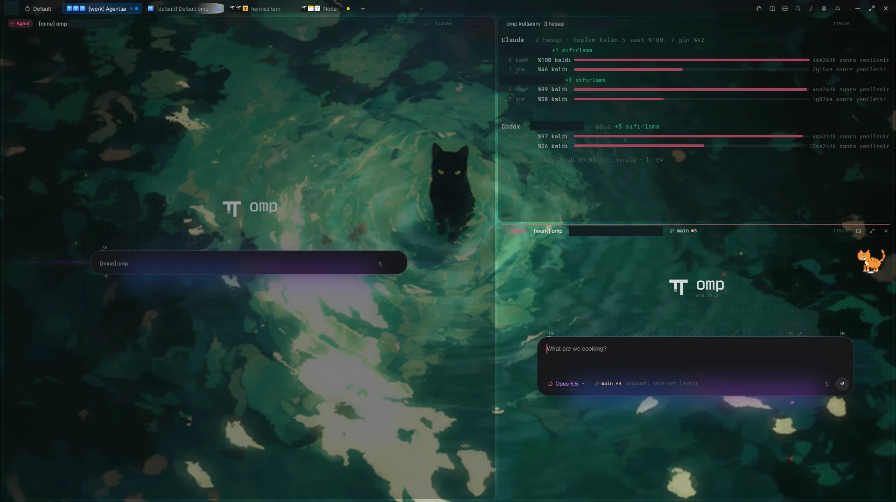
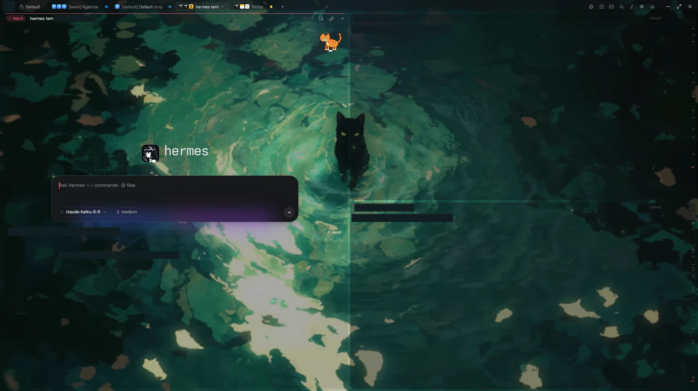

# tern-plugins

Plugins for [Tern](https://docs.stencil.so/tern/), one installable folder each.

| Plugin | What it does |
| --- | --- |
| [omp-usage](omp-usage) | Remaining usage limits of every account across all omp profiles, in one pane |
| [omp-profile](omp-profile) | The omp profile each pane runs, in every split's header (with its omp extension), the tab title and the status line |
| [split-columns](split-columns) | Turns a grid of split rows into columns, so each column's divider moves on its own |
| [mods](mods) | Switchable UI mods (tab styles, profile accents, focus mode, privacy blur, live wallpaper, composer and busy animations, …) with a settings panel and your own CSS mods |
| [hermes-bridge](hermes-bridge) | Connects Carly, Hermes and omp, with a shortcut to open a live Hermes tab for each field device |
| [todo-jira](todo-jira) | Assigned Jira issues in Tern’s Markdown TODO board, reviewed edits, Hermes Kanban and private memory drafts |

omp extensions (no Tern half; installed through omp's `config.yml`, see their READMEs):

| Extension | What it does |
| --- | --- |
| [omp-account](omp-account) | `/account`: which OAuth account of the model's provider this conversation uses, shown in the status line |
| [omp-artifacts](omp-artifacts) | Claude-style artifacts: the agent's `artifact` tool saves HTML, SVG, Markdown, Mermaid or code with versions and shows it in a Tern browser pane beside the chat |

## Workspace showcase

This is a live Tern workspace on Windows, not a preset. **Agentlar** keeps personal (`mine`) and work (`work`)
omp profiles open beside a shared quota panel. **Default omp** is a separate tab for one-off work,
and **Notlar** keeps notes and canvas blocks out of the coding tabs.



The **Hermes** tab runs the native chat from [Emirfs/hermes-tern](https://github.com/Emirfs/hermes-tern) beside two shells.
The same fork also supports a separate **ESP** workspace with one live Hermes tab per device.



Account names and local paths are redacted. The wallpaper is a personal [Backdrop](https://github.com/avcton/tern-backdrop)
configuration; these plugins do not install the wallpaper or recreate the tabs.

## Example mods

Browse the [mod gallery](examples) for three small styles with real Tern previews and install recipes:
Signal Tabs, Split Compass and Reading Measure. Try them independently as plugins or as CSS files in Mods.

## Install

```sh
tern plugin install github.com/Emirfs/tern-plugins/<plugin>
```

To work on a clone in place, link a plugin folder instead: `tern plugin link <clone>/<plugin>`. Tern reloads
a linked plugin when its files change.

Type-check a plugin against the API your Tern ships with, and run its tests. The tools are pinned in
`rokit.toml` (`rokit install`), or take [luau-lsp](https://github.com/JohnnyMorganz/luau-lsp/releases) and
[lune](https://github.com/lune-org/lune/releases) releases:

```sh
tern plugin types .
luau-lsp analyze --platform=standard --definitions=@tern=tern.d.luau <plugin>/*.luau <plugin>/lib/*.luau
lune run <plugin>/tests/run.luau   # omp-usage, split-columns
```

## License

MIT
