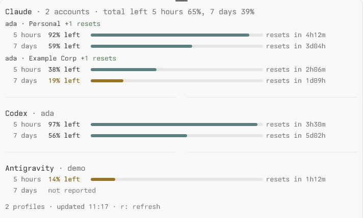
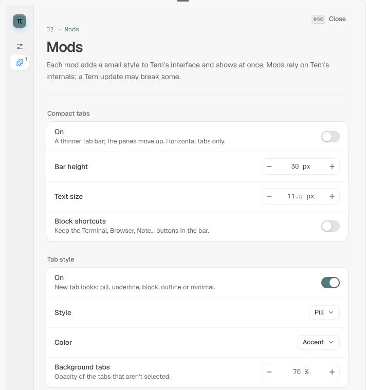
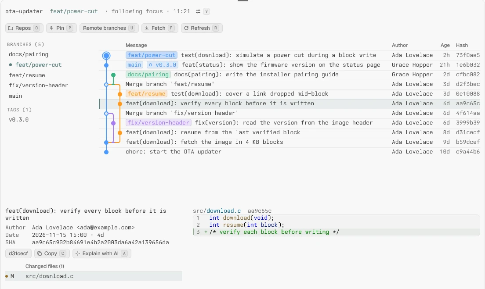
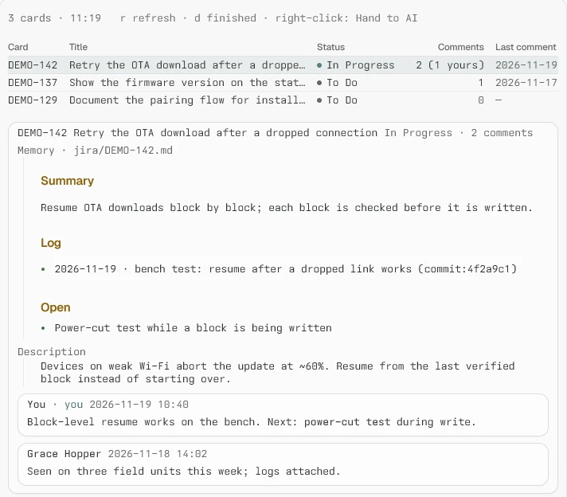
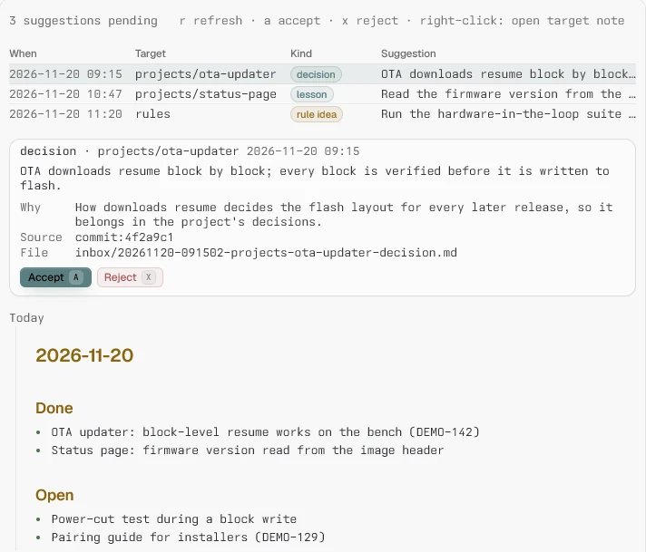
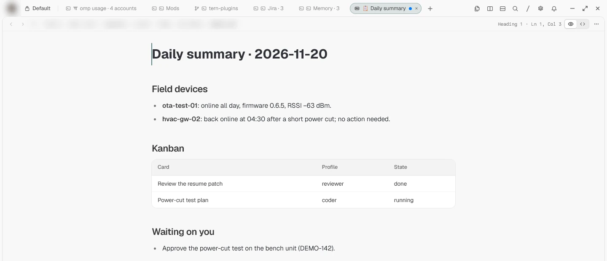

# tern-plugins

Plugins for [Tern](https://docs.stencil.so/tern/), Stencil's terminal, and two extensions for
[omp](https://github.com/can1357/oh-my-pi), the coding agent that runs in it. Each plugin is its own folder:
install only the ones you want.

| Plugin | In one line |
| --- | --- |
| [omp-usage](#omp-usage) | Remaining usage limits of every account across all omp profiles, in one pane |
| [omp-profile](#omp-profile) | Which omp profile each pane runs, in the pane title, the tab and the status line |
| [mods](#mods) | Switchable restyles for Tern (tabs, panes, wallpaper, agent chat, focus and privacy modes) plus your own CSS |
| [split-columns](#split-columns) | Lets each column of a split grid resize on its own |
| [git-graph](#git-graph) | A repository's commit graph with colored branch lanes, commit details and diffs |
| [todo-jira](#todo-jira) | Your assigned Jira cards on Tern's TODO board, a Jira pane with comments, reviewed write-back |
| [hafiza](#hafiza) | The inbox of a shared memory vault (accept or reject what agents propose) and today's note |
| [hermes-bridge](#hermes-bridge) | Connects Carly, Hermes and omp; `tern-bridge` queues jobs for the Tern window |
| [omp-account](#omp-account) | omp extension: pick which account of a provider a conversation uses |
| [omp-artifacts](#omp-artifacts) | omp extension: Claude-style artifacts shown in a browser pane beside the chat |
| [examples](#mod-examples) | Three small CSS mods with previews: Signal Tabs, Split Compass, Reading Measure |

The screenshots are real Tern panes with made-up data (sample accounts, cards, notes and a sample repository).

## Install

```sh
tern plugin install github.com/Emirfs/tern-plugins/<plugin>
```

To work on a clone in place, link a folder instead: `tern plugin link <clone>/<plugin>`; Tern reloads a linked
plugin when its files change. The omp extensions are not Tern plugins: add them to omp's `config.yml` (see
their sections). Tested on Tern 0.9.x for Windows.

---

## omp-usage

**Shows how much of every AI subscription you have left**, across all of your omp profiles (`default` and
`~/.omp/profiles/*`), in one pane. An account signed in to several profiles is counted once.



- Each limit window (5 hours, 7 days, …) shows the percent left, a bar and the time until it resets; a
  provider with several accounts shows the total.
- Yellow below 20% left, red when exhausted; `+N resets` marks limit resets you can still redeem.
- Open it from the command palette: **Open omp usage (all accounts)**, or `Ctrl+Alt+Shift+U`. `r` refreshes.

[Details](omp-usage/README.md)

## omp-profile

**Tells panes from different omp profiles apart** (`omp --profile work`, …): the pane title and the tab read
`[work] ⟨session title⟩`, and the status line shows `omp: work`. Two parts: a small omp extension that sets the
title, and a Tern plugin for the status line.

[Details](omp-profile/README.md)

## mods

**Small switchable restyles for Tern**, from a settings panel: compact tabs, tab styles, a color per omp
profile, focus mode, privacy blur for screen recordings, pane gaps and corners, a wallpaper (gradient or image),
the agent chat's composer and question cards, busy animations, and a folder for your own CSS. Every mod starts
off.



- Command palette: **Mods** opens the panel; changes apply at once in every window.
- **Mods: toggle focus mode** (`Ctrl+Alt+Z`) and **Mods: toggle privacy blur** work without the panel.

[Details and the list of mods](mods/README.md)

## split-columns

**Makes each column of a split grid resize on its own.** Tern keeps splits as a tree, so a 2×2 grid built row
by row has one horizontal divider across both columns: raising it on the right raises it on the left too. The
plugin rebuilds such a grid column by column, moving the panes (programs keep running), so every column gets
its own divider:

```
Before                     After
┌──────┬──────┐            ┌──────┬──────┐
│  A   │  B   │            │  A   │  B   │
├──────┼──────┤  ───────▶  │      ├──────┤
│  C   │  D   │            ├──────┤  D   │
└──────┴──────┘            │  C   │      │
                           └──────┴──────┘
```

It runs on its own when you split, close or switch panes; **Split grid into columns** does it on demand.

[Details](split-columns/README.md)

## git-graph

**A repository's commit graph as a Tern pane**, laid out like Fork: branches and tags on the left, every branch
in its own colored lane, and below it the selected commit, its files and the diff.



- It follows the repository of the focused terminal, or stays pinned to one; **Git graph: pick a repo** lists
  every repository under `~/GitHub`.
- Only safe writes, each asked first: switch branch (refused on a dirty tree), create a branch, fetch. It never
  commits, pushes, resets, merges or deletes.
- **Explain with AI** summarizes a commit with a cheap model, once per commit.

[Details](git-graph/README.md)

## todo-jira

**Your assigned Jira cards on Tern's own `~/TODO.md` board**, kept in sync, plus a read-only **Jira pane** with
every comment of every card.



- **Refresh from Jira** fills the `Todo`, `Doing` and `Done` lanes; later changes come in every five minutes.
- Edits on the board (title, due date, lane) go back to Jira only through **Changes**, one field at a time,
  with Jira's allowed transitions; nothing is written behind your back.
- **Hand to AI** turns a card into a Hermes kanban task with its description and latest comments.
- Each card keeps a note in a memory vault (`jira/<KEY>.md`); a filled **Jira draft** section is offered as the
  card's next comment.

The Jira API token is read from a file and never shown or passed on the command line. [Details](todo-jira/README.md)

## hafiza

**The inbox of a shared memory vault**, a Markdown folder that several agents write to. Agents propose
summaries, decisions, lessons and rule ideas; this pane lists them so you can **Accept** (`a`, applied to the
target note and committed) or **Reject** (`x`) each one, and shows today's daily note.



The pane never writes to the vault itself; the vault's own tool does. Command palette: **Memory: suggestions
and today**. [Details](hafiza/README.md)

## hermes-bridge

**Connects Carly (Tern's assistant), [Hermes Agent](https://github.com/NousResearch/hermes-agent) and omp.**
Carly gets tools to ask Hermes, create kanban cards and open a field device's live Hermes tab. The `tern-bridge`
CLI lets Hermes, omp or any script queue jobs that the plugin runs in the Tern window:

```sh
tern-bridge carly "Put the agents side by side in one tab"
tern-bridge omp --cwd C:\repo "Fix the failing test"
tern-bridge read --title "Daily summary" --key daily-2026-11-20 summary.md
tern-bridge notify --level success "Build is green"
```



`read` opens a Markdown file as a new tab of the session you are looking at, once per key. [Details](hermes-bridge/README.md)

## omp-account

An omp extension (not a Tern plugin): **`/account` picks which login of the current model's provider a
conversation uses**, for a profile with several accounts of one provider (a personal and a work Claude
subscription, say). The status line shows the account in use. [Details](omp-account/README.md)

## omp-artifacts

An omp extension (not a Tern plugin) that gives agents **Claude-style artifacts**: pages, SVG images, diagrams,
documents and code files shown in a browser pane beside the conversation, every change kept as a version.
`/artifacts` lists and reopens them. [Details](omp-artifacts/README.md)

## Mod examples

Three small styles, each with a preview, a recipe and an installable plugin:
[Signal Tabs](examples/signal-tabs/RECIPE.md), [Split Compass](examples/split-compass/RECIPE.md) and
[Reading Measure](examples/reading-measure/RECIPE.md). See the [gallery](examples).

---

## Development

Type-check a plugin against the API your Tern ships with, and run its tests. The tools are pinned in
`rokit.toml` (`rokit install`), or take [luau-lsp](https://github.com/JohnnyMorganz/luau-lsp/releases) and
[lune](https://github.com/lune-org/lune/releases) releases:

```sh
tern plugin types .
luau-lsp analyze --platform=standard --definitions=@tern=tern.d.luau <plugin>/*.luau <plugin>/lib/*.luau
lune run <plugin>/tests/run.luau
python -B -m unittest discover -s todo-jira/tests
```

## License

MIT
