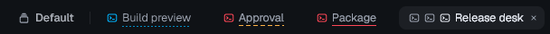
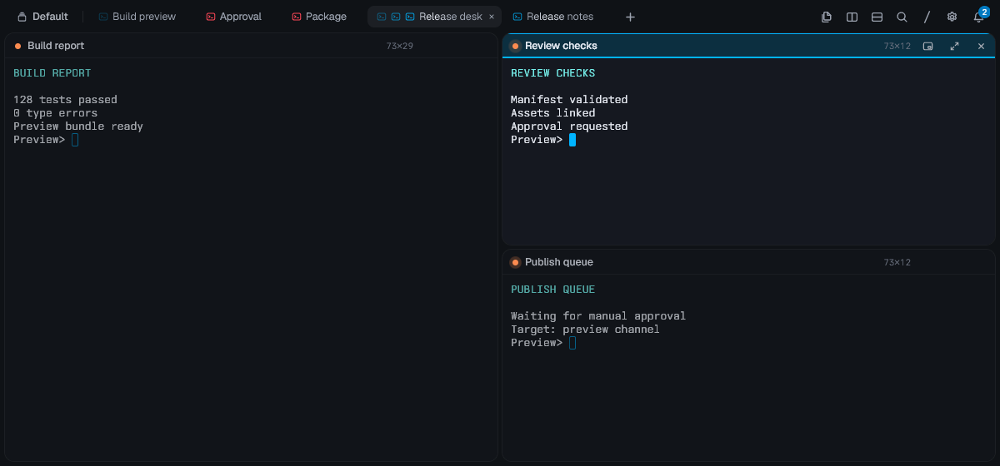
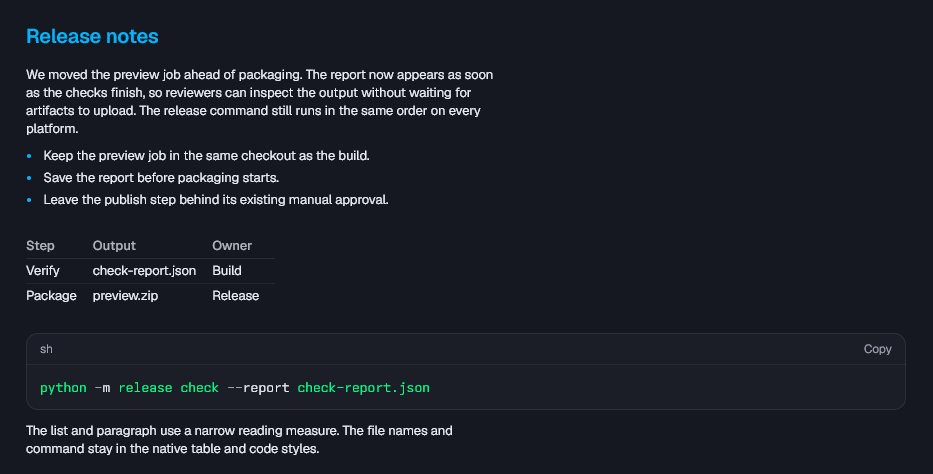

# Tern mod examples

Three small, independent styles for Tern. Each folder has a preview, a recipe and an installable plugin. They follow your Tern theme and never dim text or run background commands.

### Signal Tabs

Dotted for running, dashed for waiting, solid for failure. Native tab names, selection and badges stay in place.

[Install and try Signal Tabs](signal-tabs/RECIPE.md)

### Split Compass

The active pane header picks up a tint and an accent edge. Switch panes to move the cue without dimming or resizing any split.

[Install and try Split Compass](split-compass/RECIPE.md)

### Reading Measure

Prose wraps to a comfortable column in Reader chat, while tables and code blocks keep their native widths.

[Install and try Reading Measure](reading-measure/RECIPE.md)

## Compatibility

Tested on Tern 0.9.27 for Windows. The previews are crops of Tern's own renderer using illustrative release notes and shell output, not live account or project data. These styles target Tern's UI classes, which may change in a later release.

No other plugin is required. If you already use [Mods](../mods), you can copy each `.css` file to its `user-mods` folder instead and enable it from **Your mods**. Use one installation method per style. Disable overlapping styles if you want to compare an example to stock Tern.
