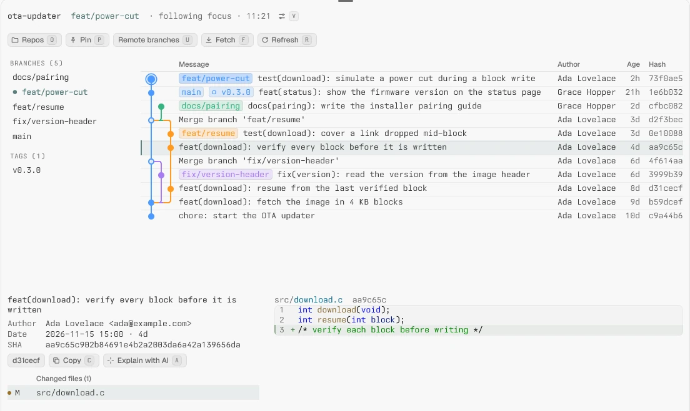

# Git graph

A repository's commit graph as a Tern pane, laid out like Fork: branches, remote branches and tags on the left;
the commit list with colored lanes in the middle; below it the selected commit, its changed files and the
selected file's diff side by side. The idea comes from [mykeura/git-gui](https://github.com/mykeura/git-gui);
`git` must be on the PATH.



## Opening it

| Command | What it does |
|---|---|
| **Git graph: new pane (follows the focused terminal)** | Follows the repo of the focused terminal (or omp/agent pane); when focus moves to another repo, the graph moves with it |
| **Git graph: this folder's repo (pinned)** | Pins the focused terminal's repo |
| **Git graph: pick a repo** | Filter-as-you-type picker over every repo under `~/GitHub` |

Each command opens a new pane: several repos can sit side by side, and panes can be moved and parked.
In the pane, **Repos** (`o`) opens the same picker, and **Pin / Follow focus** (`p`) switches between following and pinned.

## Using it

- **Graph**: every branch is an unbroken line in its own color; a filled dot is a commit, a ring is a merge, a
  dot with a halo is HEAD. `style.css` draws the lines; if the style does not load, the same graph shows in
  box-drawing characters (`│ ● ╮ ╯`). Branch labels sit before the message in the commit's lane color (as in
  Fork): the current branch is bold, `☁` marks a remote branch, `⌂` a tag. **Remote branches** (`u`) draws
  remote branches too. The first 400 commits are read; the button at the end of the table loads the next page.
- **Branches**: local branches (the current one marked `●`), each remote under its own heading, and tags;
  clicking one selects that ref's commit. A column on the left in a wide pane, a strip above the list in a
  narrow one.
- **Lower section**: selecting a commit shows its message body, author, date, SHA, parents (click one to jump
  to it), the Jira keys in the message and the changed files; the first file's diff opens right beside them.
  Click another file or press `[` `]` to change the diff. For merges, files are relative to the first parent
  (what the PR brought in).
- **Right-click** a commit: copy the hash, open on the web (GitHub/GitLab), create a branch here, explain with
  AI, switch to the branches on that commit, open the Jira card and the card's note in the vault.
- **Keys**: `↑` `↓` / `j` `k` commit, `r` refresh, `f` fetch, `c` copy hash, `w` web, `b` create branch, `a` AI,
  `v` View.
- Every 15 seconds the pane checks where the branches and HEAD are; it re-reads history only if something moved.

## View: narrow and wide panes

The settings button in the header (`v`) opens the **View** panel in the lower section. A pane below a certain
width (in columns) counts as **narrow**, above it as **wide**; the toolbar, left column, graph, branch names,
author, age, hash and lower section can each be turned on or off separately for narrow and wide. The view
changes by itself as the pane grows and shrinks.

- The threshold is set with `Threshold −10` / `Threshold +10` or **Threshold = current width** (default 110 columns).
- Defaults: in a narrow pane the toolbar, author and hash are off (branches show as a strip on top); in a wide
  pane everything is on. With the toolbar off, the keys keep working.
- The setting is stored per pane; **Open new panes like this too** makes it the default for newly opened panes.

## What it writes

Only safe actions that you start:

- **Switch to branch**: refuses if the working tree has uncommitted changes; otherwise asks for confirmation,
  then runs `git switch` (`git switch --track` for a remote branch).
- **Create branch**: asks for a name, validates it with `git check-ref-format`, runs `git branch <name> <commit>`
  (does not switch to it).
- **Fetch**: `git fetch --all`; never prompts for a password (`GIT_TERMINAL_PROMPT=0`).

It never commits, pushes, resets, merges or deletes.

## AI explanation

**Explain with AI** gives the commit's message, stats and diff (at most 12,000 characters) to a cheap model and
shows an English summary of at most 5 bullets in the lower section. Default: `omp -p --no-tools … --model haiku`;
no tools, session, rules or context files are loaded. The result is stored per commit, so the same commit is
never paid for twice.

## Settings

`config.json` in the plugin's data folder (on Windows `%LOCALAPPDATA%\Tern\plugin-data\git-graph\`); every key
is optional:

```json
{
  "roots": ["C:\\Users\\me\\GitHub"],
  "depth": 4,
  "jira_url": "https://inohom64.atlassian.net",
  "jira_projects": ["FRMWR"],
  "vault": "C:\\Users\\me\\GitHub\\araclar\\hafiza",
  "ai_argv": ["omp", "-p", "--no-tools", "--model", "haiku"]
}
```

- `roots`, `depth`: the folders the **Repos** picker scans, and how deep (`node_modules`, `.venv` and hidden
  folders are skipped; it does not descend into a repo).
- `jira_projects`: only keys of these projects count as cards (`UTF-8` and `SHA-256` do not).
- `vault`: the card note `jira/<KEY>.md` and the project note `projects/<repo>.md` are opened from here.

## Tests

```sh
lune run git-graph/tests/run.luau
```

Covers lane layout, the parsers, commands against real git in a temporary repo, and the pane end to end in a
fake runtime (switch confirmation, refusal on a dirty tree, focus following, the AI cache).
