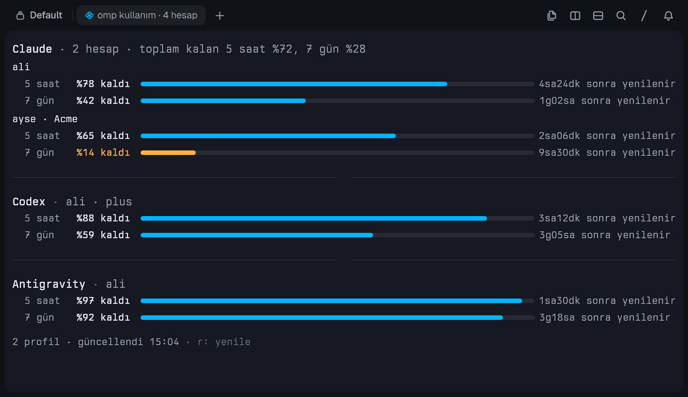

# omp-usage

Shows the remaining usage limits of every account across all of your
[omp](https://github.com/can1357/oh-my-pi) profiles (`default` and `~/.omp/profiles/*`) in one Tern
pane. An account signed in to several profiles is counted once.

<picture>
  <source media="(prefers-color-scheme: light)" srcset="docs/screenshot-light.png">
  
</picture>

The screenshot is the plugin's own view code rendered with sample accounts.

## Install

```sh
tern plugin install github.com/Emirfs/tern-plugins/omp-usage
```

Requires Tern 0.9.5 or later, and the `omp` CLI on the machine that runs your panes.

## Usage

- Command palette (`Ctrl+Shift+P`): **Open omp usage (all accounts)** opens the pane beside the focused
  one, or focuses it if this window already has one. **New omp usage block** opens the same pane.
- Key bind: `Ctrl+Alt+Shift+U`.
- `r` refreshes; `R` clears omp's usage cache (`omp usage invalidate`) and then refreshes. Data refreshes on
  its own every 2 minutes; reset countdowns update every 30 seconds.

## What it shows

- One group per provider. Each account lists its limit windows (5 hours, 7 days; a limit with its own quota
  pool gets its own window) with the remaining percentage, a bar that is full when the quota is untouched,
  and the time until the window resets. A cell is the account's most-used limit in that window, the same
  rule omp's `capacity` uses.
- A provider with several accounts shows the total remaining per window in its heading.
- Below 20% left turns yellow, an exhausted limit red. `+N resets` marks usage-limit resets the account can
  still redeem.
- The last line names the profiles read and the last refresh, `(cached)` until this pane's first fetch
  finishes. A `⚠` line reports a profile that could not be read or an account that was disabled. A profile
  whose fetch fails keeps showing its last good data, and the `⚠` line says from when.

The pane never needs scrolling. When the stacked view above does not fit, it switches to a table with one
row per account; as the pane narrows, the bars go first, then the reset columns, then the e-mail
addresses, and the narrowest panes get a list. In a short pane, providers with several accounts collapse to
their total row.

## How it works

The host half runs `omp [--profile <name>] usage --json` for each profile (with `OMP_PROFILE` set, plus
`PI_CODING_AGENT_DIR` for the default profile), deduplicates accounts by provider and e-mail/organization,
and keeps the freshest report of each account. A limit that reports no usage is left out, never shown as
untouched. `omp` is looked up on `PATH` first, then, on Windows, at `%LOCALAPPDATA%\Tern\omp\bin\omp.exe` and
`~/.bun/bin/omp.exe`; elsewhere at `~/.bun/bin/omp`, `/opt/homebrew/bin/omp` and `/usr/local/bin/omp`.

After each fetch the fields the pane reads (accounts' e-mail and organization, limits, reset times; no
tokens) are saved as `cache` in the plugin's `tern.kv` (`<Tern data>/plugin-data/omp-usage/kv.json`), so a
new pane draws at once instead of waiting for omp.

Layout: `host.luau` (the block: state, omp runs, cache, view), `lib/usage.luau` (reports into accounts,
deduplication, the cache's trimmed copy), `lib/layout.luau` (what fits a pane size), `lib/fmt.luau`,
`lib/text.luau` (the pane's text), `window.luau` (palette command).

## Tests

From the repository root, with [lune](https://github.com/lune-org/lune) (`rokit install` installs the
pinned version):

```sh
lune run omp-usage/tests/run.luau
```

They cover the `lib/` modules and run `host.luau` end to end under a stub of Tern's runtime: cache before
the first fetch, a failing profile keeping its data, the Windows omp lookup, the key handling.
