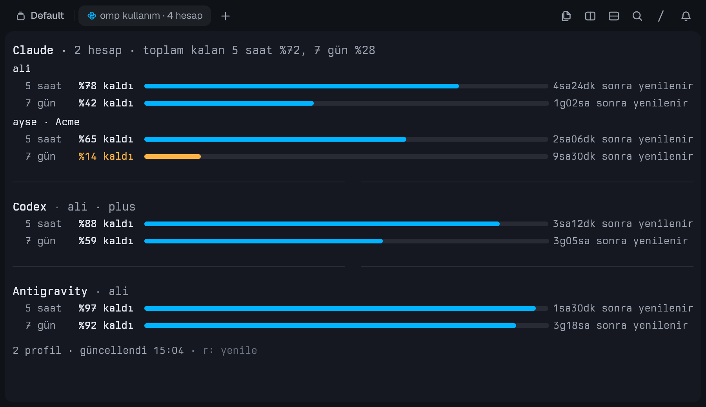

# omp-usage

Shows the remaining usage limits of every account across all of your
[omp](https://github.com/can1357/oh-my-pi) profiles (`default` and `~/.omp/profiles/*`) in one Tern
pane. An account signed in to several profiles is counted once.

<picture>
  <source media="(prefers-color-scheme: light)" srcset="docs/screenshot-light.png">
  
</picture>

The screenshot is the plugin's own view code rendered with sample accounts. The pane's labels are in
Turkish: `saat` = hours, `gün` = days, `kaldı` = left, `sonra yenilenir` = resets in, `hesap` = account,
`toplam kalan` = total left.

## Install

```sh
tern plugin install github.com/Emirfs/tern-plugins/omp-usage
```

Requires Tern 0.9.5 or later, and the `omp` CLI on the machine that runs your panes.

## Usage

- Command palette (`Ctrl+Shift+P`): **omp kullanımını aç (tüm hesaplar)** opens the pane beside the
  focused one, or focuses it if this window already has one. **New omp kullanım block** opens the same pane.
- Key bind: `Ctrl+Alt+Shift+U`.
- `r` refreshes; `R` clears omp's usage cache (`omp usage invalidate`) and then refreshes. Data refreshes on
  its own every 2 minutes; reset countdowns update every 30 seconds.

## What it shows

- One group per provider. Each account lists its limit windows (5 hours, 7 days; a limit with its own quota
  pool gets its own window) with the remaining percentage, a bar that is full when the quota is untouched,
  and the time until the window resets. A cell is the account's most-used limit in that window, the same
  rule omp's `capacity` uses.
- A provider with several accounts shows the total remaining per window in its heading.
- Below 20% left turns yellow, an exhausted limit red. `+N sıfırlama` marks usage-limit resets the account
  can still redeem.
- The last line names the profiles read and the last refresh. A `⚠` line reports a profile that could not
  be read or an account that was disabled.

The pane never needs scrolling. When the stacked view above does not fit, it switches to a table with one
row per account; as the pane narrows, the bars go first, then the reset columns, then the e-mail
addresses, and the narrowest panes get a list. In a short pane, providers with several accounts collapse to
their total row.

## How it works

The host half runs `omp [--profile <name>] usage --json` for each profile (with `OMP_PROFILE` set, plus
`PI_CODING_AGENT_DIR` for the default profile), deduplicates accounts by provider and e-mail/organization,
and keeps the freshest report of each account. `omp` is looked up on `PATH` first, then at
`%LOCALAPPDATA%\Tern\omp\bin\omp.exe` and `~/.bun/bin/omp`.
